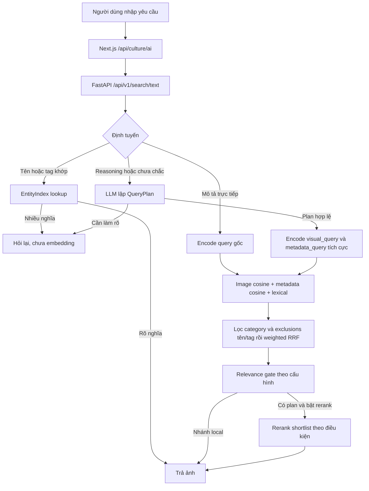

# Kiểm thử cập nhật query và phân tích embedding — 08/11/2026

Kiểm tra tại commit `7d31ea1` (`update phân loại query`). Không sửa thuật toán,
`.env`, model hoặc embedding corpus trong lượt kiểm tra này.

**Kết luận kiểm thử**

- Python: **213 passed**, 33 giây, một cảnh báo deprecation của Starlette/AnyIO.
- Ruff: `All checks passed!` với `services packages scripts`.
- Frontend: `npm run typecheck` đạt; `node --test tests/*.test.cjs` đạt cả hai file.
- SigLIP2 thật, CPU, cache model offline: sáu truy vấn qua service, năm truy vấn
  đối chứng image/metadata/lexical/fusion, semantic text search, image self-search
  và tái tạo một metadata vector đều hoàn tất.
- LLM thật: thử hai truy vấn, cả hai trả `openai_authentication_failed`.
  Chưa xác nhận chất lượng diễn giải/rerank của provider hiện được cấu hình.
- Chưa chạy kiểm tra tương tác trình duyệt hoặc smoke toàn tuyến Next.js → API
  bằng một server đang phục vụ. Kiểm thử API trong pytest dùng TestClient.

Lần pytest trong sandbox treo lúc khởi tạo Starlette TestClient, trước khi gửi
request. Chạy lại ngoài sandbox đạt toàn bộ 213 bài. Đây là khác biệt môi trường
kiểm thử; không sửa production để xử lý hiện tượng đó.

**Thay đổi mới nhất và ý nghĩa**

Planner đổi `requirements` và `preferences` từ chuỗi thành object `{id, text}`:

```json
{
  "requirements": [
    {"id": "R1", "text": "Có hai người trong cùng một ảnh"},
    {"id": "R2", "text": "Hai người mặc áo dài đỏ hoặc xanh"}
  ],
  "preferences": [
    {"id": "P1", "text": "Ảnh toàn cảnh"}
  ]
}
```

Đây là ví dụ cấu trúc theo thiết kế, không phải output của một lần gọi model thật
trong lượt kiểm tra này. “Đỏ hoặc xanh” phải giữ lựa chọn OR; toàn cảnh chỉ là ưu
tiên. ID có phạm vi trong một plan, không phải ID toàn cục.

Backend kiểm tra R1…R8 và P1…P4 liên tiếp, không trùng hoặc nhảy số, text sau trim
có 1–240 ký tự, không nhận field thừa hoặc định dạng danh sách chuỗi cũ. Sai plan
được yêu cầu sửa tối đa một lần; vẫn sai thì dừng trước embedding. Cache theo
`(query, category)` giữ nguyên object và ID. API và reranker nhận đầy đủ object;
frontend hiển thị `condition.text`.

Các bài hồi quy đã kiểm tra validation, sửa plan một lần, giữ ID qua cache,
chuyển requirements/preferences đến selector, clarification trước encoding,
không embed đối tượng bị loại trừ và tôn trọng kết quả rỗng của selector.
Chúng dùng provider giả lập. JSON hợp lệ chưa chứng minh model diễn giải đúng
ý nghĩa, và ID điều kiện chưa phải cơ chế xác minh từng điều kiện trên từng ảnh.

**Cấu hình và dữ liệu thực tế**

| Thuộc tính | Giá trị trong lần chạy |
| --- | --- |
| Artifact | `data/embeddings/culture-labels-v1` |
| Số asset | 15.423; khớp tập ID của manifest corpus |
| Được phép tìm kiếm | 15.411; 12 asset có `search_excluded` |
| Image / metadata matrix | Mỗi ma trận 15.423 × 768, float32, L2 |
| Model | `google/siglip2-base-patch16-224` |
| Revision | `75de2d55ec2d0b4efc50b3e9ad70dba96a7b2fa2` |
| LLM / routing / rerank | Bật / auto / bật |
| Query roles | Bật |
| Rerank evidence | `annotations` |
| Relevance gate | `shadow`, chưa cấu hình policy |

Nạp artifact đã đi qua checksum, shape, finite values, chuẩn L2 và kiểm tra ID.
Không lấy thông tin index cũ trong báo cáo ngày 06/11 để thay cho cấu hình này.

**Luồng chuẩn bị dữ liệu: hai cách biểu diễn cùng một asset**

```text
Ảnh gốc → sửa EXIF orientation → RGB → processor → SigLIP2 image tower
        → chuẩn hóa L2 → vectors.npy, hàng i

keyword + tags + description → ghép văn bản → chia token thành các đoạn
        → SigLIP2 text tower → chuẩn hóa từng đoạn → cộng → chuẩn hóa L2
        → metadata_vectors.npy, hàng i

assets.jsonl, hàng i → asset_id, đường dẫn ảnh và annotation tương ứng
```

Image embedding nhận pixel; tên file, description và VQA answers không đi vào
image encoder. Nó là một vector tóm tắt ảnh để xếp hạng độ tương đồng với ảnh
hoặc mô tả, không lưu toàn bộ pixel hay một danh sách thuộc tính đã được chứng minh.

“Description embedding” trong hệ thống thực tế là **metadata embedding**:
`keyword` (đổi `_` thành khoảng trắng), tags, description; nếu tất cả rỗng thì
dùng category. Không lấy VQA answers/questions hay cultural_context vào hàm ghép
metadata này. Hai vector độc lập được gắn với cùng asset; không có bước đưa vector
ảnh vào text encoder để tạo metadata vector trong pipeline đang kiểm tra.

Text tower có ngân sách 64 token. `encode_documents` chia đoạn theo ngân sách sau
khi trừ special tokens, encode từng đoạn, chuẩn hóa rồi gộp. Vì vậy description dài
không bị cắt bỏ toàn bộ phần sau đoạn đầu; tuy nhiên gộp nhiều đoạn thành một vector
có thể làm loãng chi tiết hiếm. Đây cũng là cách encode query của `/search/text`.
`/search/semantic` dùng `encode_texts`, từ chối text vượt 64 token.

Vector cùng số chiều chưa đủ để ghép tùy ý giữa hai model. Pipeline này dùng hai
tower của cùng model/revision và giữ mapping hàng nhất quán. Nếu thay metadata
encoder, phải có query encoder tương thích cho riêng kênh đó.

Tái tạo một metadata vector từ annotation hiện tại cho cosine
**0,99999988** với hàng được lưu. Kết quả xác nhận mẫu đó khớp preprocessing và
mapping, không thay thế kiểm tra tái tạo toàn bộ corpus. Dùng chính một ảnh corpus
để query tìm lại đúng asset ở hạng 1, cosine **1,0**.

**Luồng truy vấn hiện tại**



Trong `auto`, lookup tên/tag được thử trước classifier. Nếu không khớp, classifier
nhỏ quyết định mô tả trực tiếp hay cần planner. `use_llm=true` ép planner;
`use_llm=false` giữ local. Cờ bật LLM toàn backend vẫn là điều kiện bắt buộc.

Không có plan: một query vector được so với cả hai ma trận. Có plan và bật query
roles: `visual_query` vào kênh ảnh, `metadata_query` vào kênh metadata, `keywords`
vào lexical. Query gốc chứa phủ định không được embed trong nhánh planned; điều
kiện âm đi qua exclusions/requirements. Nếu tắt roles, mỗi kênh dense lấy cosine
lớn nhất qua các query tích cực đã encode.

Exclusions lọc tên/tag, không quét pixel hoặc chứng minh sự vắng mặt của một vật.
Category và exclusions được áp trước khi lấy top của từng kênh để fusion.
Metadata không nhắc “nón” không có nghĩa ảnh không có nón. Nhánh local không có
plan nên cũng không tự có một bộ thực thi điều kiện phủ định đáng tin.

**Tác dụng và giới hạn của từng kênh**

| Kênh | Bằng chứng sử dụng | Giá trị thực tế | Giới hạn |
| --- | --- | --- | --- |
| Image embedding | Pixel | Tìm nội dung thị giác, ảnh tương tự; bổ sung khi chú thích thiếu | Cosine không bảo đảm số lượng, quan hệ hoặc phủ định |
| Metadata embedding | Tên + tags + description | Tìm mô tả gần nghĩa, bổ sung tên văn hóa và thông tin annotation | Có thể kế thừa annotation sai; text–text similarity chưa được chấm chất lượng riêng |
| Lexical | Token trong tên/tags/description | Giữ bằng chứng khớp chữ cụ thể | Không hiểu đầy đủ ngữ cảnh; từ chung có thể kéo ảnh sai chủ đề |
| Entity lookup | Cụm tên/tag và biến thể | Bỏ qua chi phí encoder khi đã có cụm khớp | Phụ thuộc độ đúng/đầy đủ của nhãn, có thể trả ít ảnh hơn dense search |

Hai embedding bổ sung vì cùng ảnh có hai nguồn bằng chứng: những gì thể hiện trên
pixel và những gì annotation nói về ảnh. Không có bảo đảm rằng kết hợp luôn tốt hơn:
annotation sai có thể làm metadata và lexical cùng ủng hộ một kết quả sai. Ba kênh
không phải ba phép xác minh độc lập.

**Cách phối hợp: hợp nhất thứ hạng, giữ riêng hai vector**

Vì vector chuẩn L2, dot product với query chuẩn hóa tương đương cosine. Kênh
lexical dùng trọng số token theo trường: tên **3**, tags **2**, description **1**;
token query lặp không cộng thêm. Có inverted postings để tránh quét lại toàn bộ
description mỗi request. Đây không phải BM25.

Mỗi kênh lấy tối đa 100 ứng viên theo mặc định; lexical chỉ góp ứng viên có điểm
dương. Weighted Reciprocal Rank Fusion tính:

```text
score(asset) = Σ weight(channel) / (60 + rank(channel, asset))
```

Rank bắt đầu từ 1; asset không nằm trong top của kênh nào thì không nhận đóng góp
từ kênh đó. Cấu hình kiểm tra có ba trọng số đều bằng 1. Rank 1 một kênh góp
`1/61 ≈ 0,01639`; rank 1 cả ba góp khoảng `0,04918`.

Như vậy hệ thống không cộng trực tiếp vector ảnh với vector description, cũng
không cộng raw cosine ảnh với raw cosine metadata. RRF giảm phụ thuộc vào sự khác
thang điểm giữa các kênh, nhưng bỏ qua khoảng cách điểm và không tạo xác suất liên
quan. Không diễn giải score 0,04 thành độ chính xác 4% hoặc 96%.

Đối chứng dưới đây bỏ qua router và dùng cùng query/corpus để chỉ so các kênh.
Tên ở bảng là tên asset hạng 1, không phải nhãn chấm relevance:

| Query | Chỉ ảnh | Chỉ metadata | Chỉ lexical | Fusion |
| --- | --- | --- | --- | --- |
| bánh chưng | Bánh chưng Tết | Gói bánh chưng | Lễ hội bánh chưng | Bánh chưng Tết |
| người mặc áo dài đỏ | Áo dài Việt Nam | Đám cưới Việt Nam | Áo dài Việt Nam | Áo dài cách tân |
| nghệ nhân làm gốm | Gốm Phù Lang | Gốm Chu Đậu | Gốm Chu Đậu | Gốm Chu Đậu |
| green terraced rice fields in the mountains | rice field Vietnam | rice field Vietnam | Làm bánh in | rice field Vietnam |
| tàu vũ trụ trên sao Hỏa | Rằm tháng Bảy | Lăng Hồ Chí Minh | Muong Hoa valley | Tranh lụa |

Bảng xác nhận các kênh góp bằng chứng khác nhau và fusion có tác động; không đủ
để tuyên bố fusion tốt hơn bằng một tỷ lệ phần trăm. Kênh lexical có thể khớp các
token tiếng Anh thông dụng trong query dài, nên kết quả riêng của nó vẫn có thể
lệch chủ đề.

**Quan sát trên đường tìm kiếm thực tế**

- `bánh chay`: lookup, không gọi encoder/LLM, top là ảnh nhãn `Tết Hàn thực`.
- `pho`: hỏi lại local, không retrieval; lựa chọn hiện tại gồm `bánh phô mai`,
  `phố`, `phở`. Lựa chọn phụ thuộc vocabulary của corpus.
- `người mặc áo dài đỏ`: khớp tag, trả hai ảnh lễ hội, không chạy fusion.
  Đã xem ảnh đầu: bàn bánh chưng là tiền cảnh, người mặc áo đỏ ở phía sau.
  Nhãn khớp có thể đúng nhưng bố cục chưa chắc đáp ứng mong đợi của người dùng.
- `người mặc áo dài đỏ đứng cạnh cửa gỗ`: hybrid, top `Áo dài cách tân`.
  Chưa xác minh đủ thuộc tính cửa gỗ trên ảnh đó.
- `ruộng bậc thang xanh ở vùng núi`, filter phong cảnh: hybrid; đã xem ảnh đầu,
  có ruộng bậc thang xanh và núi trong nền.
- `nghệ nhân làm gốm`: hybrid; đã xem ảnh đầu, có người vẽ trang trí lên bình gốm.
  Ảnh này thể hiện một công đoạn làm gốm; không phải bằng chứng về thao tác nặn đất.

Đây là lý do cùng một câu mô tả có thể đi lexical trên corpus thật nhưng đi hybrid
trong fixture kiểm thử nhỏ: corpus thật có tag khớp nguyên cụm. Cần phân biệt
`/search/text` (router + hybrid) với `/search/semantic` (text/image query chỉ so
image vectors). Giao diện Từ khóa là một baseline khác.

Hybrid đầu tiên mất khoảng 7,34 giây gồm tải model; hai query hybrid tiếp theo
khoảng 106–114 ms. Lặp lại có cache vector khoảng 5–7 ms. Đây là phép đo trong
process cho vài query trên máy hiện tại, không bao gồm mạng/web, không phải P95,
benchmark đồng thời hoặc SLA.

**Giới hạn cần xử lý trước khi coi luồng là hoàn chỉnh**

1. **Provider LLM chưa chạy được.** Hai truy vấn thật đều lỗi xác thực/quyền
   truy cập. Cần kiểm tra credential/quyền model rồi chạy lại. Không thay cấu hình
   hoặc thử in khóa. Kiểm thử giả lập chỉ xác nhận orchestration và contract.
2. **Chưa từ chối query ngoài miền.** Query sao Hỏa vẫn có top-K dù không phù hợp.
   `shadow` không loại kết quả; hiện cũng chưa có policy được cấu hình. Cần hiệu
   chỉnh trên nhãn có/không có đáp án rồi mới bật enforce. Không đặt ngưỡng RRF
   hoặc cosine tùy ý. Policy local chưa tự áp được cho planned/exact profile.
3. **Chưa có bằng chứng theo từng điều kiện.** `{id, text}` tạo nền để nối R1/R2
   với bằng chứng sau này, nhưng selector hiện trả candidate ID và lý do chung.
   Chưa có trạng thái thỏa/không thỏa/chưa biết cho mỗi condition.
4. **Rerank hiện chỉ đọc annotation.** Cờ bật rerank chỉ áp cho nhánh có plan;
   local lookup/hybrid không gọi reranker. Pixel evidence là tùy chọn đã có,
   nhưng cần model phù hợp và đánh giá sai số trước khi dùng để kiểm chứng chi tiết.
5. **Router là xấp xỉ và phụ thuộc ngôn ngữ.** Probe classifier với câu mô tả
   tiếng Anh `green terraced rice fields in the mountains` cho `reasoning_intent`
   dù là mô tả trực tiếp. Điều này có thể gọi LLM thừa trong auto; chưa đo tỷ lệ
   lỗi trên tập tiếng Anh. Muốn baseline thuần local dùng `use_llm=false`.
6. **Chưa có thước đo chất lượng đủ nhãn.** File pool hiện có 200 query nhưng
   không query nào có answerable boolean hoặc judgment được chấm. Không công bố
   nDCG/Precision hay lợi ích của fusion từ các placeholder đó.

Ưu tiên thực tế: khôi phục quyền gọi provider để chạy smoke plan mới; chấm một
tập query độc lập có điều kiện và ngoài miền; đối chứng các kênh trên cùng nhãn;
hiệu chỉnh relevance gate; sau đó đánh giá verifier theo từng condition và pixel
reranking. Chưa có bằng chứng cần embedding lại toàn bộ ảnh chỉ để phục vụ thay
đổi schema điều kiện vừa thêm.

**Mã nguồn và bằng chứng để đối chiếu**

- `services/api/src/visualseek_api/application/query_understanding.py`: schema,
  validation, prompt, selector và pixel evidence.
- `services/api/src/visualseek_api/application/search.py`: routing, cache, query
  roles, orchestration và response.
- `packages/embedding/src/visualseek_embedding/metadata.py`: nội dung metadata.
- `packages/embedding/src/visualseek_embedding/siglip2.py`: hai tower và chunking.
- `packages/retrieval/src/visualseek_retrieval/hybrid.py`: lexical, cosine, RRF.
- `services/api/tests/test_semantic_planning.py`: hồi quy schema điều kiện mới.
- `data/diagnostics/search-update-verification-2026-11-08.json`: kết quả local,
  ablation, timings, self-search, tái tạo metadata.
- `data/diagnostics/search-planner-live-2026-11-08.json`: lỗi provider thật.

Các file trong `data/` là artifact local bị Git ignore. Runner tương ứng được
lưu cùng thư mục diagnostics để có thể chạy lại, không chứa API key.
